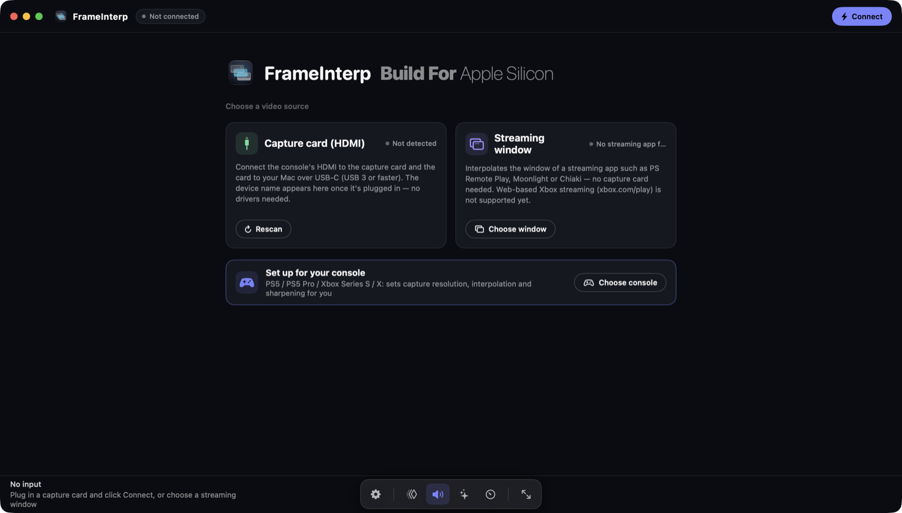
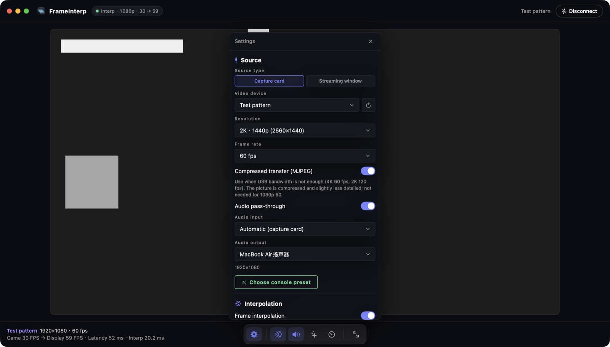

# FrameInterp

**Real-time frame interpolation for console games on Apple Silicon Macs — turn 30 fps into 60 fps.**

[中文说明](README.zh-CN.md)

FrameInterp takes the picture from a USB capture card (or the window of a streaming app), removes duplicate
frames, generates the in-between frames with Apple's low-latency frame interpolation (VideoToolbox), and shows the
result on your Mac's screen. Audio from the capture card is passed straight through.



## Features

- **30 → 60 fps** with Apple's `VTLowLatencyFrameInterpolation` (runs on the Media Engine / Neural Engine, about 18 ms per frame on an M2).
- **Capture cards**: any USB (UVC) capture card that macOS sees as a camera — Genki ShadowCast, Elgato, AVerMedia, MS2109-based cards… 1080p / 2K / 4K, 60 / 120 fps, automatic fallback when USB bandwidth is not enough.
- **Streaming windows**: PS Remote Play, Moonlight, Chiaki and similar apps, captured at their native pixels. Windows in a separate full-screen Space are supported.
- **Subtitle & HUD guard**: subtitles and HUD elements that stay still are copied from the real frame, so they don't shimmer or warp in interpolated frames.
- **Sharp scaling**: frames are scaled straight to the screen's physical pixels (Catmull-Rom upscaling, area-correct downscaling for 4K) with optional RCAS sharpening.
- **Console presets**: pick PS5 / PS5 Pro / Xbox Series S / X and get recommended capture, interpolation and sharpening settings.
- Audio pass-through with selectable input and output devices, FPS / latency HUD, detailed logs.



## Requirements

- A Mac with Apple Silicon (M1 or later). Intel Macs are not supported.
- **macOS 26 or later.**
  - On **macOS 26**, Apple's low-latency interpolation only accepts up to 1280×720, so FrameInterp interpolates at 720p.
  - On **macOS 27**, interpolation runs at 1080p.
- A USB capture card (USB 3 recommended), or a streaming app window.

### Not supported (yet)

- **Web-based Xbox streaming (xbox.com/play in a browser).** The web page pauses as soon as the browser loses
  focus, which conflicts with FrameInterp showing the interpolated picture in front. Embedding the page inside
  FrameInterp is planned.
- HDR capture (turn HDR off on the console).

## Install

1. Download the latest `FrameInterp-x.y.dmg` from [Releases](../../releases) and drag **FrameInterp** into **Applications**.
2. The app is not notarized by Apple. The first time you open it, macOS says it cannot verify the developer:
   open **System Settings → Privacy & Security**, scroll down and click **Open Anyway**.
3. Allow **Camera** (reads the capture card) and **Microphone** (plays the capture card's audio). For streaming
   windows, also allow **Screen & System Audio Recording**.

## Usage

1. Connect the console's HDMI to the capture card and the card to your Mac.
2. Click **Connect** (or choose a streaming window on the home page).
3. Press **Space** (or the interpolation button in the dock) to turn interpolation on. It is meant for 30 fps games;
   60 fps games don't need it.

Shortcuts: `Space` interpolation on/off · `F` full screen · `⌘,` settings · `⌘I` FPS / latency HUD · `⌘Q` quit.

Tips:
- Turn **HDR off** on the console; capture cards don't support it and the picture looks washed out.
- Interpolation works at 1080p at most (720p on macOS 26). Capturing at 2K / 4K only helps when interpolation is off.
- Logs are in `~/Library/Logs/FrameInterp/`. Please attach the latest one when reporting a problem.

## Build from source

```bash
swift build -c release          # binary: .build/release/FrameInterp
./make-app.sh                   # FrameInterp.app (ad-hoc signed)
./make-release.sh               # DMG in the parent folder
```

Requires Xcode 26 / Swift 6 toolchain on macOS 26+. Useful command-line flags for development:

```bash
.build/release/FrameInterp --list               # list capture devices and formats
.build/release/FrameInterp --test --windowed    # built-in test pattern, no capture card needed
.build/release/FrameInterp --windows            # list capturable windows
```

Technical notes (in Chinese) are in [docs/DEV-NOTES.zh-CN.md](docs/DEV-NOTES.zh-CN.md) and the change log in [更新日志.txt](更新日志.txt).

## License

[GNU General Public License v3.0](LICENSE). Third-party code and trademarks: see [THIRD_PARTY_NOTICES.md](THIRD_PARTY_NOTICES.md).

FrameInterp is an independent project and is not affiliated with Apple, Sony, Microsoft, Genki or any capture card maker.
