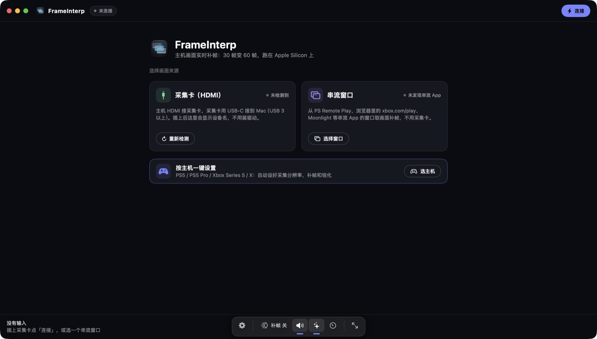
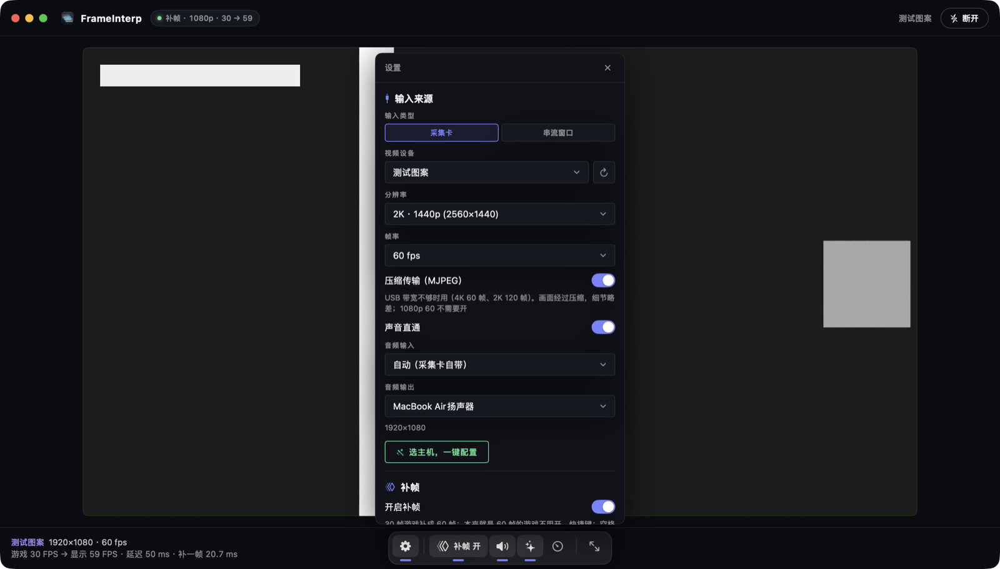

# FrameInterp

**在 Apple 芯片的 Mac 上给主机游戏实时补帧：30 帧变 60 帧。**

[English](README.md)

FrameInterp 从 USB 采集卡（或串流 App 的窗口）取画面，去掉重复帧，用 Apple 的低延迟补帧（VideoToolbox）补出中间帧，
显示在 Mac 屏幕上。采集卡的声音直接直通。



## 功能

- **30 → 60 帧**：用 Apple 的 `VTLowLatencyFrameInterpolation`，M2 上每帧约 18ms。
- **采集卡**：系统能当摄像头认出来的 USB 采集卡都能用（Genki ShadowCast、Elgato、AVerMedia、MS2109 方案的卡等），
  支持 1080p / 2K / 4K、60 / 120 帧；USB 带宽不够时自动退到能跑的档。
- **原生 Xbox 串流（实验）**：登录微软账号，在列表里选你的 Xbox，画面直接串进 FrameInterp——不用采集卡、不用浏览器。和主机在同一个网络时效果最好（最高 1440p60）；走公网时主机按网速自己定分辨率。Wi-Fi 下 macOS 的 AWDL（隔空投送 / 接力）可能引起周期性小卡顿，用网线可以避开。
- **串流窗口**：PS Remote Play、Moonlight、Chiaki 等串流 App 的窗口，按原始像素采集；串流窗口是系统全屏（单独一个桌面）也能用。
- **模拟器窗口**：能认出 Dolphin、PCSX2、DuckStation、PPSSPP、RetroArch、RPCS3 等 Mac 模拟器，并列出每个模拟器要改的设置（后台输入、失去焦点暂停）。请用手柄操作，键盘鼠标会被 FrameInterp 收走。60 帧的游戏要 120Hz 屏幕才能补到 120。
- **字幕和提示保护**：停住不动的字幕、HUD，在补出来的帧里用真实画面，不闪、不变形。
- **清晰放大**：画面直接缩放到屏幕实际像素（放大用三次插值，4K 缩小按比例取样防闪烁），可选 RCAS 锐化。
- **按主机一键配置**：选 PS5 / PS5 Pro / Xbox Series S / X，自动设好采集、补帧和锐化。
- 声音直通（可选输入、输出设备）、帧数和延迟浮窗、详细日志。



## 系统要求

- Apple 芯片的 Mac（M1 及以后），不支持 Intel Mac。
- **macOS 26 或更新**。
  - **macOS 26**：Apple 低延迟补帧最多处理 1280×720，所以用 720p 补帧。
  - **macOS 27**：用 1080p 补帧。
- USB 采集卡（建议 USB 3 接口），或串流 App 的窗口。

### 暂不支持

- **网页版 Xbox 串流（浏览器里的 xbox.com/play）**：浏览器一失去焦点网页就暂停。请用内置的原生 Xbox 串流。
- 原生 Xbox 串流的手柄震动。
- HDR 采集（请在主机上关掉 HDR）。

## 安装

1. 从 [Releases](../../releases) 下载最新的 `FrameInterp-x.y.dmg`，把 **FrameInterp** 拖进「应用程序」。
2. 这个 App 没有 Apple 公证，第一次打开会提示无法验证开发者：打开「系统设置 → 隐私与安全性」，往下拉，点「仍要打开」。
3. 允许「摄像头」（读采集卡画面）和「麦克风」（播放采集卡的声音）。用串流窗口时还要允许「录屏与系统录音」。

## 使用

1. 主机 HDMI 接采集卡，采集卡接 Mac。
2. 点「连接」（或在首页选一个串流窗口）。
3. 按空格（或底部坞里的补帧按钮）打开补帧。适合 30 帧的游戏，本来就是 60 帧的游戏不用开。

快捷键：空格 补帧开关 · F 全屏 · ⌘, 设置 · ⌘I 帧数和延迟 · ⌘Q 退出。

提示：
- 主机上**关掉 HDR**：采集卡不支持，开着画面发灰。
- 补帧最高 1080p（macOS 26 上 720p）；采 2K / 4K 只在不补帧时更清楚。
- 日志在 `~/Library/Logs/FrameInterp/`，反馈问题时请附上最新的一份。

## 从源码编译

```bash
swift build -c release          # 程序：.build/release/FrameInterp
./make-app.sh                   # 生成 FrameInterp.app（自签名）
./make-release.sh               # 在上一级文件夹生成 DMG
```

原生 Xbox 串流要用 WebRTC 框架（社区编译的 Google WebRTC，BSD 许可），不在仓库里。先运行一次 `tools/fetch-webrtc.sh`
下载到 `Vendor/` 并核对校验和，之后 `./make-app.sh` 就会带上原生串流；没有它时编出来的版本不带原生串流。

需要 macOS 26+ 和 Xcode 26 / Swift 6 工具链。技术笔记见 [docs/DEV-NOTES.zh-CN.md](docs/DEV-NOTES.zh-CN.md)，更新记录见 [更新日志.txt](更新日志.txt)。

## 许可证

[GNU 通用公共许可证 v3.0（GPL-3.0）](LICENSE)。第三方代码和商标说明见 [THIRD_PARTY_NOTICES.md](THIRD_PARTY_NOTICES.md)。

FrameInterp 是独立项目，和 Apple、Sony、Microsoft、Genki 及任何采集卡厂商都没有关系。
